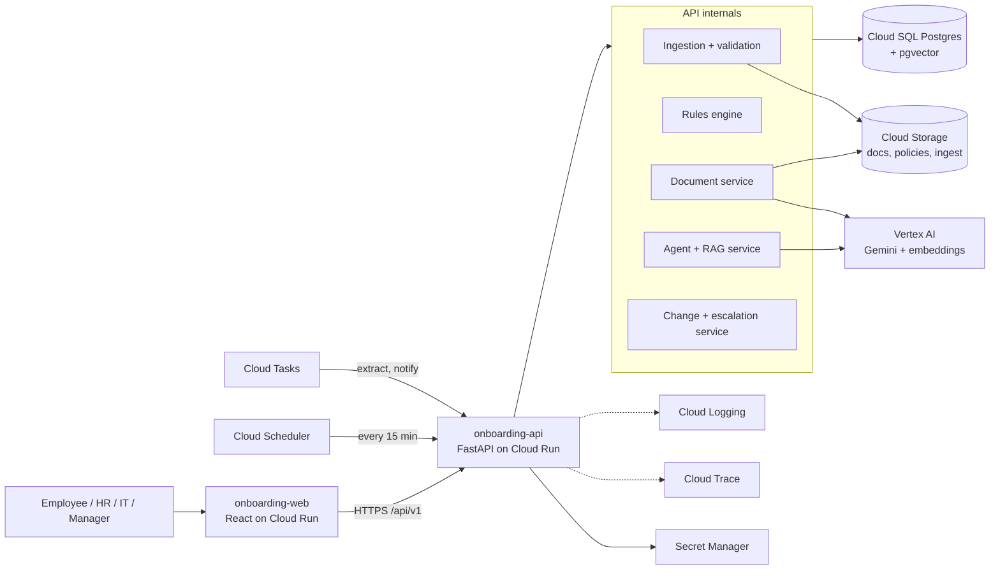

# HR Onboarding Agent: Single Source of Truth

Last updated: 2026-10-31

This is the base document for every build decision. If code and this doc disagree, fix the doc first.

## Table of contents

1. Project overview
2. Tech stack and GCP service mapping
3. System architecture and request flows
4. Data model and file formats
5. Rules engine
6. AI agent design
7. API specification (FastAPI)
8. Frontend
9. Repo structure, environments, deployment, observability, security
10. Synthetic data, build plan, test and demo script, risks

---

## 1. Project overview

We are building a working, GCP-hosted HR Onboarding Agent that turns a new joiner's profile into a rule-driven checklist, tracks and validates documents, provisions IT, answers policy questions from approved sources only, and re-plans automatically when dates or roles change.

### 1.1 Goal and principles

- **Real behaviour, not a demo.** The organiser assesses the running app, so every feature is backed by a live API, a database write and a visible UI change.
- **Rules decide, AI explains.** Checklists, due dates, owners and escalations come from a deterministic rules engine. The LLM is used for document extraction, policy Q&A, explanations and drafting messages, never for deciding what is required.
- **Grounded or silent.** The assistant answers only from approved policy chunks, cites the source, and says "I can't find that in the approved policies" otherwise.
- **Recalculate, don't rebuild.** Every task stores the rule and the anchor (joining date, HR record, approval) that produced it, so a change re-derives only what is affected.
- **Every action is audited.** Each state change, AI call and escalation writes an audit row and a Cloud Trace span.

### 1.2 Scope by level

| Level | Window | What ships |
| --- | --- | --- |
| Level 1 | 0 to 3 hours | Ingestion (CSV, Excel, JSON) with validation, rule-based checklists with rule explanation, document upload and status tracking, document and record validation with extraction mismatch, grounded chat assistant, progress dashboard |
| Level 2 (planned) | Next | Employee profile creation, IT provisioning workflow with dependencies, role-specific templates and policy acknowledgement |
| Level 3 (planned) | Later | Joining-date and role change replanning, delayed-approval escalation, readiness score and extras |

The schema, services and API are designed for all three levels so Level 1 code does not need rework later.

### 1.3 Scenarios covered

1. Pre-joining document collection and correction
2. Employee profile creation and IT provisioning
3. Role-specific onboarding and policy acknowledgement
4. Joining-date and role changes
5. Employee questions and delayed approvals

### 1.4 Differentiators (extra credit)

- **Onboarding Readiness Score** (0 to 100 per joiner and per cohort) with a "Day-1 Ready" flag, weighted by blocking tasks.
- **Critical-path view** showing which single pending item blocks the most downstream tasks (a rejected ID blocks HR record, laptop, email and access).
- **Explain-this-item** button on every checklist row showing the rule, source policy and dependencies.
- **Auto-drafted nudges** to employees and owners, grounded in the exact missing item and deadline.
- **Change impact preview** showing diffs of tasks, dates and owners before a joining-date or role change is applied.
- **Metrics page** with measurable improvements: median time to Day-1 ready, documents rejected on first pass, chase messages avoided, escalations resolved.

### 1.5 Success metrics

| Metric | Target |
| --- | --- |
| Checklist generated per joiner | under 2 seconds, 100% of items carry a rule reference |
| Grounded answers with a citation | 100%; zero invented requirements on the test set |
| Joining-date change replan | under 3 seconds, only dependent tasks touched |
| Ingestion validation | every bad row reported with row number and reason |
| Day-1 readiness | tracked per cohort, shown on dashboard |

---

## 2. Tech stack and GCP service mapping

React and FastAPI on Cloud Run, Postgres on Cloud SQL, files in Cloud Storage, Gemini on Vertex AI for every AI call, everything observable through Cloud Logging and Cloud Trace.

### 2.1 Stack

| Layer | Choice | Why |
| --- | --- | --- |
| Frontend | React 18, TypeScript, Vite, Tailwind CSS, shadcn/ui, TanStack Query, TanStack Table, React Router, Recharts | Fast build, accessible components, strong table and filter support |
| Backend | Python 3.12, FastAPI, Pydantic v2, SQLAlchemy 2, Alembic, Uvicorn | Typed contracts, automatic OpenAPI, async I/O |
| Database | Cloud SQL for PostgreSQL 15 with pgvector | One store for relational data, audit and policy embeddings |
| File storage | Cloud Storage (private buckets, signed URLs) | Uploaded documents and policy files |
| LLM | Vertex AI Gemini (Flash for chat and extraction, Pro if harder reasoning is needed) | Native GCP, IAM auth, no API keys |
| Embeddings | Vertex AI text-embedding model, stored in pgvector | Grounded retrieval without a separate vector DB |
| Document extraction | Gemini multimodal on the uploaded file; Document AI as optional upgrade | Reads IDs and certificates, extracts name, DOB, dates |
| Async work | Cloud Tasks (retries) and Cloud Scheduler (overdue sweeps) calling internal endpoints | Serverless, no queue to run |
| Observability | Cloud Logging (structured JSON), Cloud Trace via OpenTelemetry, Cloud Monitoring | Logs and tracing requirement |
| Secrets and config | Secret Manager, Cloud Run env vars | No secrets in code |
| Build and deploy | Artifact Registry, Cloud Build, Cloud Run (two services) | One-command deploys |
| Auth | Level 1: demo role switcher (Employee, HR, IT, Manager). Upgrade path: Identity Platform or IAP | Keeps the first 3 hours on features |

### 2.2 GCP resource map

| Resource | Name (suggested) | Used for |
| --- | --- | --- |
| Project | onboarding-agent-prod | Single project for the event |
| Region | asia-south1 (Mumbai); Vertex AI location per model availability | Latency from Bengaluru |
| Cloud Run service | onboarding-api | FastAPI backend |
| Cloud Run service | onboarding-web | React static build served by nginx |
| Cloud SQL instance | onboarding-pg | Postgres 15, private IP, pgvector enabled |
| Cloud Storage bucket | onboarding-docs-{project} | Employee uploads (private, versioned) |
| Cloud Storage bucket | onboarding-policies-{project} | Approved policy and process guides |
| Cloud Storage bucket | onboarding-ingest-{project} | Uploaded CSV, Excel, JSON |
| Service account | sa-api | Cloud SQL Client, Storage Object Admin on the buckets, Vertex AI User, Secret Accessor, Cloud Trace Agent, Logs Writer |
| Service account | sa-tasks | Invoker role on internal endpoints for Cloud Tasks and Scheduler |
| Artifact Registry | onboarding-repo | Container images |
| Secret Manager | db-password, app-config | Credentials |
| Cloud Tasks queue | onboarding-jobs | Document extraction, provisioning, notifications |
| Cloud Scheduler job | overdue-sweep (every 15 minutes) | Detect overdue tasks and escalate |

Region and instance sizes are assumptions to confirm; treat them as defaults.

---

## 3. System architecture and request flows

### 3.1 Component diagram



### 3.2 Request flows

**A. Ingest and generate checklist**
1. HR uploads joiners.csv. API stores the raw file in the ingest bucket and parses it.
2. Each row is validated (mandatory fields, date format, manager and department references). Valid rows are upserted; invalid rows are returned with row, field and reason.
3. For each new joiner the rules engine generates tasks with owners, due dates, dependencies and explanations.
4. Audit rows and an ingestion_runs record are written; the dashboard reflects the new joiners.

**B. Document upload and validation**
1. Employee uploads a file; API checks type and size, stores it in the docs bucket, sets status Submitted, enqueues an extraction job.
2. Cloud Tasks calls /internal/jobs/extract; Gemini returns structured fields and a legibility flag.
3. Validation compares extracted values with the profile, checks expiry, records mismatches.
4. Status becomes Under Review or Correction Requested; the employee sees a plain explanation. HR accepts, which completes the task and unblocks dependants.

**C. Grounded chat**
1. Employee asks a question. API loads the joiner's scope and checklist.
2. Policy chunks are retrieved with pgvector, filtered by scope.
3. Gemini answers from the chunks with function calling for live data; the post-check verifies citations.
4. Answer, citations and any proposed actions are returned and stored.

**D. Change and escalation (Level 3)**
1. HR edits the joining date or role; API returns a diff preview.
2. On confirm, one transaction updates tasks, owners and due dates, writes audit rows and notifies affected owners.
3. Scheduler calls /internal/sweep; overdue tasks are escalated owner, then backup, then department head.

### 3.3 Cross-cutting design decisions

- **Stateless API.** All state in Cloud SQL and Cloud Storage; Cloud Run can scale to zero and back.
- **Idempotent jobs.** Extraction and sweep jobs are safe to retry.
- **One transaction per business action** (generate checklist, accept document, apply change).
- **Trace everything.** OpenTelemetry spans around DB calls, Vertex AI calls and rule evaluation; trace id returned to the client and stored in audit_log.

---

## 4. Data model and file formats

Fifteen tables cover joiners, rules, tasks, documents, policies, chat and audit. Every task points to the rule that created it, which is what makes explanations and replanning possible.

### 4.1 Core tables (Cloud SQL, Postgres)

| Table | Key columns | Purpose |
| --- | --- | --- |
| departments | id, name, head_employee_id | Valid department references |
| employees_managers | id, name, email, department_id | Valid manager references |
| owners | id, function (HR, IT, FACILITIES, COMPLIANCE), department_id, name, email, backup_owner_id | Task owner routing and escalation target |
| joiners | id, name, email, role, grade, department_id, location, manager_id, joining_date, original_joining_date, status, template_id, created_at | New-joiner profile |
| requirement_rules | id, code, item_type, title, conditions (JSONB), owner_function, due_offset_days, anchor, depends_on (array of rule codes), policy_id, mandatory | Rule definitions |
| checklist_templates | id, name, department, grade_band, location, rule_codes (array) | Role-specific bundles (Level 2) |
| tasks | id, joiner_id, rule_id, item_type, title, owner_id, status (Pending, In Progress, Blocked, Completed, Overdue, Cancelled), due_date, anchor, depends_on_task_ids, blocked_reason, rule_explanation, created_at, updated_at | The checklist row |
| documents | id, joiner_id, task_id, doc_type, status (Not Submitted, Submitted, Under Review, Accepted, Correction Requested), gcs_uri, mime_type, version, extracted (JSONB), mismatches (JSONB), reviewer_note, expiry_date, uploaded_at | Uploaded files and validation |
| policies | id, code, title, version, gcs_uri, applies_to (JSONB), approved_at | Approved policy catalogue |
| policy_chunks | id, policy_id, chunk_text, page, section, embedding (vector) | RAG index |
| acknowledgements | id, joiner_id, policy_id, policy_version, acknowledged_at | Policy sign-off record (Level 2) |
| provisioning_requests | id, joiner_id, kind (LAPTOP, EMAIL, ACCESS), payload, status, requested_at, fulfilled_at | IT provisioning (Level 2) |
| chat_messages | id, joiner_id, role, content, citations (JSONB), created_at | Conversation history with sources |
| audit_log | id, actor, action, entity_type, entity_id, before (JSONB), after (JSONB), trace_id, created_at | Full audit trail |
| ingestion_runs | id, source_file, kind, rows_total, rows_ok, rows_failed, errors (JSONB), created_at | Upload history with row-level errors |

### 4.2 Key relationships

- A joiner has many tasks and documents; each task optionally has one required document type.
- A task references exactly one requirement rule, and may depend on other tasks (the dependency graph drives Blocked status and the critical path).
- A policy has many chunks; each chat answer stores the chunk ids it cited.
- Joiners reference one manager, one department and one location; ingestion rejects rows with unknown references.

### 4.3 Ingestion file formats

All four datasets accept CSV, XLSX and JSON with the same logical fields.

| Dataset | Fields | Validation |
| --- | --- | --- |
| Joiners | name, email, role, grade, department, location, manager_email, joining_date | Required fields present; email format; date parses as YYYY-MM-DD (DD-MM-YYYY and DD/MM/YYYY accepted and normalised); department and manager exist; joining date not in the past |
| Requirements | code, item_type, title, role_pattern, department, location, grade_min, owner_function, due_offset_days, anchor, depends_on, policy_code | Unique code; known owner function; offset is an integer; depends_on codes exist; policy exists |
| Policies | code, title, version, file | File type PDF, DOCX, MD or TXT; unique code and version |
| Owners | function, department, name, email, backup_email | Known function; department exists |

```csv
name,email,role,grade,department,location,manager_email,joining_date
Asha Rao,asha.rao@example.com,Software Engineer,L3,Engineering,Bengaluru,vikram.s@acme.example,2026-11-16
Meera Iyer,meera.iyer@example.com,HR Executive,L2,People,Mumbai,priya.n@acme.example,2026-11-23
```

Ingestion is per row, not per file: valid rows are saved, invalid rows are returned with row number, field and reason, and the run is recorded in ingestion_runs. Re-uploading the same file is idempotent (upsert on email for joiners, code for rules).

---

## 5. Rules engine

A pure-Python module with no LLM calls produces checklists, validates documents, replans on change and escalates delays. Same input always gives the same output, which makes it testable and explainable.

### 5.1 Checklist generation

Input: a joiner and all active requirement rules. Output: a task per matching rule, each with owner, due date, dependencies and a plain-language explanation.

1. Match each rule's conditions against the joiner (role pattern, department, grade, location).
2. Resolve owner from owner_function plus the joiner's department (fallback to the global owner for that function).
3. Compute due date as anchor date plus due_offset_days (anchor is JOINING_DATE, or the date of another task such as HR_RECORD_CREATED).
4. Link depends_on to the tasks created from the referenced rule codes.
5. Set rule_explanation, for example: "Included because rule EDU-01 applies to Engineering roles at grade L2 and above (Policy HR-ONB-002, section 3)."
6. Mark tasks with unmet dependencies as Blocked with a blocked_reason naming the blocking item.

### 5.2 Starter rule set (synthetic, extendable via ingestion)

| Code | Item | Applies to | Owner | Due | Depends on |
| --- | --- | --- | --- | --- | --- |
| ID-01 | Identity proof | All | HR | 10 days before joining | none |
| ADDR-01 | Address proof | All | HR | 10 days before joining | none |
| EDU-01 | Education certificates | Roles with minimum qualification | HR | 10 days before joining | none |
| BGV-01 | Background verification | All | Compliance | 5 days before joining | ID-01, ADDR-01, EDU-01 where applicable |
| HRREC-01 | HR record creation | All | HR | 5 days before joining | ID-01, ADDR-01, EDU-01 |
| LAP-01 | Laptop request | All | IT | 3 days before joining | HRREC-01 |
| EML-01 | Email account | All | IT | 3 days before joining | HRREC-01 |
| APP-ENG-01 | Dev tools and repo access | Engineering | IT | Joining date | BGV-01, EML-01, SEC-01 |
| SEC-01 | Information security acknowledgement | All, required before production access | Compliance | Joining date | none |
| DESK-01 | Desk and access card | Office-based roles | Facilities | 2 days before joining | HRREC-01 |
| ORI-01 | Orientation schedule | All | HR | Joining date | none |

The example from the brief (laptop waits for HR record, HR record waits for verified documents) is modelled directly by the depends_on chain.

### 5.3 Document validation

Run on every upload, in this order, stopping at the first hard failure:

1. **File type and size**: allowed PDF, JPG, PNG; max 10 MB. Wrong type is rejected with the allowed list.
2. **Legibility**: Gemini reports a legibility flag; if false, status becomes Correction Requested with reason "Illegible".
3. **Extraction**: Gemini returns structured JSON (name, date of birth, document number, issue date, expiry date, issuer).
4. **Expiry**: expiry date before the joining date marks the document expired and requests correction.
5. **Profile match**: extracted name and date of birth compared with the joiner profile using normalised, case-insensitive fuzzy matching (token ratio 85 or above passes; initials and order tolerated). Any mismatch is stored in mismatches and highlighted.
6. **Outcome**: auto-flag only; a human reviewer confirms Accepted or Correction Requested for anything with a mismatch. Clean documents move to Under Review for HR one-click accept.

The employee always sees a plain explanation, for example: "The name on your passport reads 'Asha R. Rao' but your profile says 'Asha Rao'. Please upload a clearer copy or contact HR if your profile needs updating."

### 5.4 Document status machine

| From | To | Trigger |
| --- | --- | --- |
| Not Submitted | Submitted | Employee uploads a file |
| Submitted | Under Review | Automatic validation passes without hard failure |
| Submitted | Correction Requested | Hard failure (type, illegible, expired) |
| Under Review | Accepted | HR accepts |
| Under Review | Correction Requested | HR rejects or a mismatch is confirmed |
| Correction Requested | Submitted | Employee re-uploads (version increments) |

Accepting a document completes its task and re-evaluates dependants; any dependent task whose blockers are all complete moves from Blocked to Pending.

### 5.5 Change handling (Level 3, designed now)

Trigger: joining date changed, or role, grade, department or location changed.

1. Compute the new task set from the rules with the new joiner values.
2. Diff against existing tasks: keep, update (new due date or owner), add, cancel.
3. Preserve completed tasks and accepted documents unless the change makes them invalid (for example a different country needs a different address proof).
4. Show the diff as a preview; on confirm, apply in one transaction and notify affected owners.
5. Write one audit row per changed task with before and after values.

### 5.6 Delay detection and escalation (Level 3, designed now)

Cloud Scheduler calls the internal sweep endpoint every 15 minutes. A task past its due date, or an approval pending beyond its allowed hours, is marked Overdue and escalated: first to the task owner, then after 24 hours to the owner's backup, then after 48 hours to the department head. Each step creates a notification and an audit row, and the dashboard shows the escalation level.

### 5.7 Readiness score

```
readiness = 100 × (weighted completed tasks ÷ weighted total)
```

Blocking tasks (documents, BGV, HR record, laptop, email, security acknowledgement) have weight 3; others weight 1. A joiner is Day-1 Ready only when all blocking tasks are complete.

---

## 6. AI agent design

The agent is Gemini on Vertex AI with function calling, constrained to a fixed set of backend tools and to retrieved policy text. It can look up and act through the API; it cannot invent policy.

### 6.1 Where AI is used

| Use | Model | Input | Output |
| --- | --- | --- | --- |
| Policy Q&A | Gemini Flash | Question, joiner context, top policy chunks | Answer with citations |
| Document extraction | Gemini Flash (multimodal) | Image or PDF | JSON: legible, name, DOB, doc number, dates, issuer |
| Explain-this-item | Gemini Flash | Task, rule, policy chunk | Two-sentence plain explanation |
| Nudge and correction messages | Gemini Flash | Task, missing item, deadline, tone | Short message draft |
| Ingestion mapping help (optional) | Gemini Flash | Unknown column headers | Suggested field mapping for user to confirm |

No AI output ever changes a task status or document status by itself; the rules engine or a human does.

### 6.2 Grounded Q&A pipeline (RAG)

1. **Ingest**: policy files are split into 400 to 600 token chunks with overlap, tagged with policy code, version, section and page, embedded with the Vertex AI embedding model, and stored in policy_chunks.
2. **Scope**: before retrieval, filter policies by the joiner's role, department and location using each policy's applies_to.
3. **Retrieve**: top 6 chunks by cosine similarity (pgvector), with a minimum similarity threshold.
4. **Generate**: Gemini receives the joiner's own checklist state plus the chunks and must answer only from them.
5. **Cite**: the response returns the answer and a list of citations (policy code, title, section, page, chunk id). The UI shows them as chips that open the source passage.
6. **Refuse**: if no chunk passes the threshold, the reply is "I can't find that in the approved onboarding policies. I've flagged it to HR." and a task is created for HR.

### 6.3 Agent tools (function calling)

| Tool | Effect | Level |
| --- | --- | --- |
| get_my_checklist | Read the joiner's tasks, statuses and due dates | 1 |
| get_required_documents | Read required documents with status and rule | 1 |
| search_policy | Retrieve grounded policy chunks | 1 |
| get_task_explanation | Read the rule and source behind a task | 1 |
| request_hr_help | Create an HR follow-up task | 1 |
| submit_acknowledgement | Record policy acknowledgement after explicit user confirmation | 2 |
| raise_provisioning_request | Create laptop, email or access request when dependencies are met | 2 |
| preview_change / apply_change | Joining date or role change flow | 3 |

Write tools require the user's explicit confirmation in the UI before the backend executes them, and run with the caller's role permissions.

### 6.4 System prompt (base)

```text
You are the HR Onboarding Assistant for {company}. You help new joiners prepare for day one.
Rules:
1. Answer onboarding, document, first-day and policy questions ONLY from the provided policy excerpts and the joiner's checklist data.
2. Always cite sources as [POLICY-CODE section]. Never state a requirement you cannot cite.
3. If the excerpts do not answer the question, say you cannot find it in the approved policies and offer to notify HR. Never guess.
4. Be specific to this joiner: role {role}, location {location}, joining date {joining_date}.
5. Never reveal other employees' data. Never give legal, tax or salary advice.
6. Use tools to read or change data; never claim an action happened unless the tool returned success.
7. Keep answers short, in plain language, with next steps and deadlines.
```

### 6.5 Guardrails

- Retrieval filtered by joiner scope; answers must include at least one citation or be a refusal.
- Post-check: reject any answer whose cited chunk ids are not in the retrieved set, and retry once.
- Prompt-injection hygiene: uploaded documents and policy text are passed as data inside delimited blocks and never treated as instructions.
- PII: extracted identity values are stored only in the documents row, masked in logs (last 4 characters shown).
- Temperature 0 to 0.2 for Q&A and extraction.
- Evaluation set of 25 questions (20 answerable, 5 unanswerable) run in CI; target 100% correct refusals and 100% citation presence.

---

## 7. API specification (FastAPI)

All routes are under /api/v1, JSON in and out, documented automatically at /docs. Errors use one shape: `{"error": {"code": "...", "message": "...", "details": [...]}}`. Every request carries a trace id returned in the X-Trace-Id header.

### 7.1 Endpoints

| Method and path | Purpose | Level |
| --- | --- | --- |
| POST /ingest/{dataset} | Upload CSV, XLSX or JSON for joiners, requirements, policies or owners; returns rows_ok, rows_failed and row-level errors | 1 |
| GET /ingest/runs | History of ingestion runs | 1 |
| GET /joiners | List with filters: joining_from, joining_to, department, location, status, readiness | 1 |
| GET /joiners/{id} | Full record with checklist, documents and readiness | 1 |
| POST /joiners | Create a single joiner | 1 |
| POST /joiners/{id}/checklist/generate | Generate or regenerate the checklist from rules | 1 |
| GET /joiners/{id}/tasks | Checklist with rule explanations and blockers | 1 |
| PATCH /tasks/{id} | Update status or owner (role-checked) | 1 |
| GET /tasks/{id}/explain | Rule, policy source and dependencies for one item | 1 |
| POST /joiners/{id}/documents | Upload a file for a required document type (multipart) | 1 |
| GET /joiners/{id}/documents | Documents with status, extraction and mismatches | 1 |
| POST /documents/{id}/review | HR accepts or requests correction with a note | 1 |
| GET /documents/{id}/url | Short-lived signed URL to view the file | 1 |
| POST /chat | Send a message; returns answer, citations and any proposed actions | 1 |
| GET /chat/{joiner_id}/history | Conversation history | 1 |
| POST /policies | Upload a policy and trigger chunking and embedding | 1 |
| GET /policies | Policy catalogue | 1 |
| GET /dashboard/summary | Counts of completed, pending, blocked, overdue; filterable | 1 |
| GET /dashboard/critical-path | Items blocking the most downstream tasks | 1 |
| POST /joiners/{id}/profile/create | Populate structured HR record from approved data | 2 |
| POST /joiners/{id}/provisioning | Raise laptop, email or access requests | 2 |
| PATCH /provisioning/{id} | IT updates fulfilment | 2 |
| POST /joiners/{id}/acknowledgements | Record a policy acknowledgement | 2 |
| POST /joiners/{id}/change/preview | Show diff for a joining-date or role change | 3 |
| POST /joiners/{id}/change/apply | Apply the previewed change | 3 |
| GET /notifications | Messages and escalations for the current user | 3 |
| POST /internal/sweep | Scheduler-only overdue detection and escalation (OIDC protected) | 3 |
| POST /internal/jobs/extract | Cloud Tasks target for document extraction | 1 |
| GET /healthz | Liveness and DB check | 1 |

### 7.2 Example: chat request and response

```json
POST /api/v1/chat
{ "joiner_id": "j_102", "message": "Which documents do I need to submit before my joining date?" }

200 OK
{
  "answer": "As a Software Engineer in Bengaluru joining on 16 Nov 2026, you need identity proof, address proof and your education certificates by 6 Nov. Two are still pending: address proof and education certificates.",
  "citations": [
    { "policy_code": "HR-ONB-001", "title": "Pre-joining documents", "section": "2.1", "chunk_id": "c_881" }
  ],
  "proposed_actions": [],
  "trace_id": "4b1f..."
}
```

### 7.3 Roles and permissions (Level 1 demo auth)

| Role | Can do |
| --- | --- |
| Employee | Own checklist, own uploads, chat about own record |
| HR | All joiners, review documents, ingest data, manage rules and policies |
| IT | Provisioning tasks and statuses |
| Manager | Read-only view of direct reports' readiness |

The role is sent in X-Demo-Role and X-Demo-User headers for Level 1; the dependency that reads them is the single place to swap in Identity Platform tokens later.

---

## 8. Frontend

React + TypeScript + Vite + Tailwind + shadcn/ui. A single-page app with a role switcher in the header (Employee, HR, IT, Manager) that changes which routes and actions are visible.

### 8.1 Pages

| Route | Role | Content |
| --- | --- | --- |
| /dashboard | HR, Manager | KPI cards (Completed, Pending, Blocked, Overdue), readiness distribution, joiners table with filters (joining date range, department, location, status), critical-path panel |
| /joiners/:id | HR, Manager | Joiner header with readiness score; tabs: Checklist, Documents, Provisioning, Policies, Timeline (audit), Chat |
| /me | Employee | "My onboarding": progress ring, next actions, checklist, document upload, assistant panel |
| /ingest | HR | Drag-drop upload per dataset, validation report with row-level errors, run history |
| /policies | HR | Policy catalogue, upload, chunk and index status |
| /reviews | HR | Queue of documents Under Review with extracted vs profile values side by side and accept or request-correction actions |
| /it | IT | Provisioning queue with dependency state |
| /metrics | HR | Measurable improvement metrics (median time to Day-1 ready, first-pass acceptance, escalations) |

### 8.2 Key components

- **ChecklistTable**: columns Item, Owner, Due, Status badge, Blocked by, "Why?" button that opens a drawer with the rule, policy citation and dependencies.
- **DocumentUploader**: per-item dropzone, type and size checks client-side, live status chip (Not Submitted to Accepted), correction message with reason and re-upload button.
- **ExtractionCompare**: two-column view of extracted values vs profile with mismatches highlighted.
- **ChatPanel**: streaming answers, citation chips opening a source drawer, confirmation modal for any proposed action.
- **DashboardFilters**: URL-synced filters so views are shareable.
- **ChangePreviewDialog** (Level 3): diff table of kept, updated, added and cancelled tasks.
- **ReadinessRing** and **CriticalPathCard**.

### 8.3 Frontend conventions

- Generated API client from the FastAPI OpenAPI schema (openapi-typescript) so types match the backend.
- TanStack Query for server state; optimistic updates only for status chips.
- Accessible by default (shadcn/Radix), keyboard operable tables and dialogs.
- Status colours: Completed green, Pending grey, In Progress blue, Blocked amber, Overdue red; always paired with text, never colour alone.
- Empty, loading and error states for every list.

---

## 9. Repo structure, environments, deployment, observability, security

### 9.1 Monorepo layout

```
onboarding-agent/
├── docs/
│   └── SSOT.md                  # this document
├── backend/
│   ├── app/
│   │   ├── main.py              # FastAPI app, routers, middleware
│   │   ├── config.py            # settings from env / Secret Manager
│   │   ├── deps.py              # db session, demo auth, role checks
│   │   ├── api/                 # routers: ingest, joiners, tasks, documents, chat, policies, dashboard, internal
│   │   ├── models/              # SQLAlchemy models
│   │   ├── schemas/             # Pydantic request/response models
│   │   ├── services/
│   │   │   ├── ingestion.py
│   │   │   ├── rules_engine.py  # checklist, status, replan, escalation (pure functions)
│   │   │   ├── documents.py
│   │   │   ├── validation.py    # fuzzy match, expiry, mismatch
│   │   │   ├── rag.py           # chunk, embed, retrieve
│   │   │   ├── agent.py         # Gemini function calling, tools, guardrails
│   │   │   ├── provisioning.py
│   │   │   └── notifications.py
│   │   ├── gcp/                 # storage.py, vertex.py, tasks.py, tracing.py, logging.py
│   │   └── tests/
│   ├── alembic/                 # migrations
│   ├── Dockerfile
│   └── pyproject.toml
├── frontend/
│   ├── src/ (pages, components, api, hooks, lib)
│   ├── Dockerfile               # build then nginx
│   └── package.json
├── data/synthetic/              # sample CSV, XLSX, JSON, policies, test documents
├── eval/                        # chat evaluation set and runner
├── infra/
│   ├── setup.sh                 # gcloud bootstrap (APIs, buckets, SQL, SAs)
│   ├── cloudbuild.yaml
│   └── scheduler.sh
└── README.md
```

### 9.2 Environments and configuration

| Variable | Purpose |
| --- | --- |
| GCP_PROJECT, GCP_REGION, VERTEX_LOCATION | Project and Vertex AI location |
| DB_INSTANCE_CONNECTION_NAME, DB_NAME, DB_USER, DB_PASSWORD (secret) | Cloud SQL connection (Cloud SQL connector, no public IP) |
| BUCKET_DOCS, BUCKET_POLICIES, BUCKET_INGEST | Buckets |
| GEMINI_MODEL_FAST, GEMINI_MODEL_PRO, EMBEDDING_MODEL | Model names (configurable, not hard-coded) |
| SIMILARITY_THRESHOLD | Minimum retrieval score for answers |
| TASKS_QUEUE, TASKS_SA_EMAIL, API_BASE_URL | Cloud Tasks and internal endpoint auth |
| APP_ENV | local, staging, prod |

Local development uses Docker Compose with Postgres (pgvector image) and application default credentials for Vertex AI and Storage.

### 9.3 Deployment (Cloud Run)

1. Enable APIs: run, sqladmin, storage, aiplatform, cloudtasks, cloudscheduler, secretmanager, artifactregistry, cloudbuild, cloudtrace, logging.
2. Create service accounts and bind the roles from section 2.2.
3. Create the Cloud SQL instance and enable the vector extension (`CREATE EXTENSION vector;`).
4. Cloud Build builds backend and frontend images into Artifact Registry.
5. Deploy onboarding-api (attach Cloud SQL connection, service account, secrets, min instances 1 during the demo to avoid cold starts) and onboarding-web.
6. Run Alembic migrations as a Cloud Run job or from the build step.
7. Create the Cloud Tasks queue and the Scheduler job pointing at /internal/sweep with OIDC.
8. Seed synthetic data via the ingestion endpoints (script in infra/).

### 9.4 Observability

- **Logging**: structured JSON logs with severity, trace id, joiner id, action; PII masked.
- **Tracing**: OpenTelemetry with the Cloud Trace exporter; spans for each request, DB query batch, Vertex AI call (with model and token counts), rule evaluation and GCS operation.
- **Metrics and alerts** (Cloud Monitoring): request latency p95, error rate, Vertex AI latency, count of refusals, count of Overdue tasks, extraction failures.
- **AI audit**: every LLM call stores prompt version, retrieved chunk ids, response and latency in audit_log or a dedicated table.

### 9.5 Security and compliance

- Private buckets and signed URLs with 10-minute expiry; no public access.
- Cloud SQL on private IP; least-privilege service accounts.
- Internal endpoints accept only OIDC tokens from the designated service account.
- File validation: type, size and magic-byte check; virus scanning is a documented future item.
- Role checks on every route; employees can only read their own joiner record.
- PII minimised and masked in logs; retention policy documented as a future item.
- Synthetic data only for the event; no real identity documents.

---

## 10. Synthetic data, build plan, test and demo script, risks

### 10.1 Synthetic data pack (create first)

| File | Contents |
| --- | --- |
| joiners.csv / .xlsx / .json | 12 joiners across Engineering, People, Finance, Sales in Bengaluru, Mumbai, Delhi, including 2 rows with deliberate errors (bad date, unknown manager) |
| requirements.csv | The rules in section 5.2, plus location-specific variants |
| owners.csv | HR, IT, Facilities, Compliance owners per department with backups |
| policies/ | 6 short policy documents: Pre-joining documents (HR-ONB-001), Education and qualification (HR-ONB-002), Background verification (HR-BGV-001), IT provisioning (IT-PRV-001), Information security (SEC-POL-001), First-day guide (HR-DAY1-001) |
| documents/ | Sample ID, address proof and certificates as images or PDFs: 2 clean, 1 name mismatch, 1 expired, 1 illegible, 1 wrong file type |
| eval/questions.json | 25 chat questions with expected citations; 5 deliberately unanswerable |

### 10.2 Build plan

**Level 1 (0 to 3 hours)**

| Time | Work | Done when |
| --- | --- | --- |
| 0:00 to 0:20 | GCP bootstrap, repo skeleton, Cloud SQL, buckets, Cloud Run hello-world | API and web respond on Cloud Run URLs |
| 0:20 to 0:50 | Models, migrations, ingestion with validation, synthetic data loaded | Bad rows reported with reasons; joiners listed |
| 0:50 to 1:20 | Rules engine, checklist generation, explanations, dependencies | Checklist shows owner, due date, rule and blocker |
| 1:20 to 1:55 | Document upload, status machine, extraction and validation, HR review | Mismatch and expiry flagged; status changes visible |
| 1:55 to 2:25 | Policy ingest, embeddings, chat with citations and refusal | Role-specific answer with source; unanswerable question refused |
| 2:25 to 2:50 | Dashboard, filters, joiner detail | Filter by date, department, location, status |
| 2:50 to 3:00 | Deploy, smoke test, README | Full demo path works on Cloud Run |

**Level 2:** profile creation endpoint, provisioning requests with dependency gating, templates by department and grade, acknowledgement flow and chat tools.

**Level 3:** change preview and apply, escalation sweep, notifications, readiness score and metrics page.

### 10.3 Testing

- **Unit**: rules engine (matching, due dates, dependencies, replan diff), validation (fuzzy match, expiry), ingestion parsers, status machine. These are pure functions and should have the most tests.
- **API**: pytest with a test database; one test per endpoint for happy path and permission failure.
- **AI evaluation**: run eval/questions.json against the deployed API; fail if any answer lacks a citation, cites a chunk not retrieved, or fails to refuse an unanswerable question.
- **End-to-end smoke**: script that ingests data, uploads a bad document, asserts Correction Requested, uploads a good one, accepts it, and asserts the laptop task unblocks.

### 10.4 Demo script (5 minutes)

1. Upload joiners.csv with errors: show row-level validation report, then valid rows appear on the dashboard.
2. Open Asha Rao (Software Engineer, Bengaluru): checklist with owners, due dates, blockers and the "Why?" drawer.
3. As Asha, upload an expired ID: instant Correction Requested with a clear explanation. Upload a mismatched name: highlighted comparison for HR.
4. Ask the assistant "Which documents do I need to submit before my joining date?": role-specific answer with citation. Ask something not in policy: grounded refusal and HR task created.
5. HR accepts documents: BGV and HR record unblock; show dashboard counts and critical path change.
6. (Level 2 and 3) Move the joining date earlier: preview diff, apply, and show recalculated due dates; show an overdue approval escalated to the backup owner.
7. Show Cloud Logging and a Cloud Trace span for the chat request to evidence observability.

### 10.5 Risks and mitigations

| Risk | Mitigation |
| --- | --- |
| LLM invents a requirement | Retrieval-only answers, citation post-check, refusal path, evaluation set in CI |
| Extraction misreads a document | Human confirmation for any mismatch; confidence and legibility flags; never auto-reject without a reason shown |
| Cloud SQL or Vertex AI setup eats the 3 hours | Run infra/setup.sh first; use Docker Compose locally; keep a fallback to deploy API first and add AI after |
| Cold starts during demo | min instances 1 on onboarding-api |
| Vertex AI quota or region model availability | Model names in config; fallback to another available Flash model |
| Scope creep | Level 1 is the release; Level 2 and 3 only after the demo path passes |

### 10.6 Open decisions to confirm

- Region (assumed asia-south1) and exact Gemini and embedding model versions available in the project.
- Whether auth stays as a demo role switcher for the event or moves to Identity Platform.
- Whether Document AI is wanted in addition to Gemini for extraction.
- Company name and any real policy wording to replace the synthetic policies.
